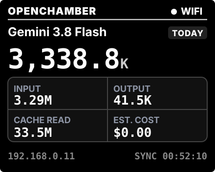
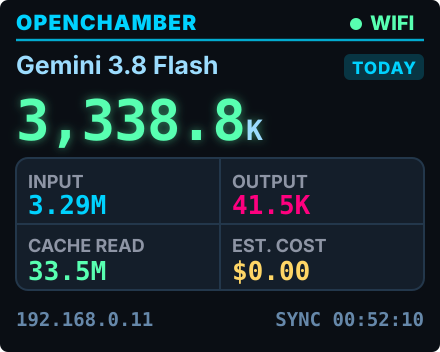
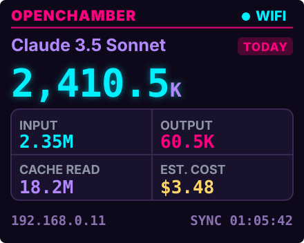
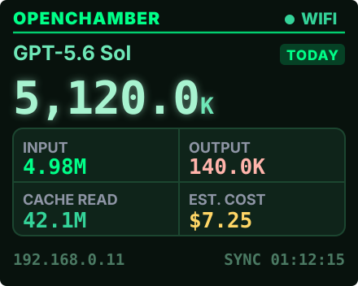
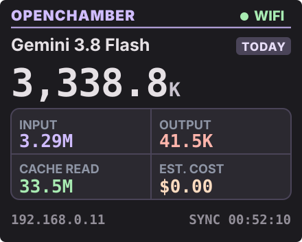
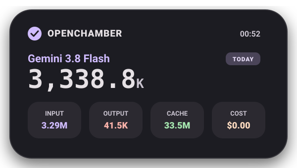
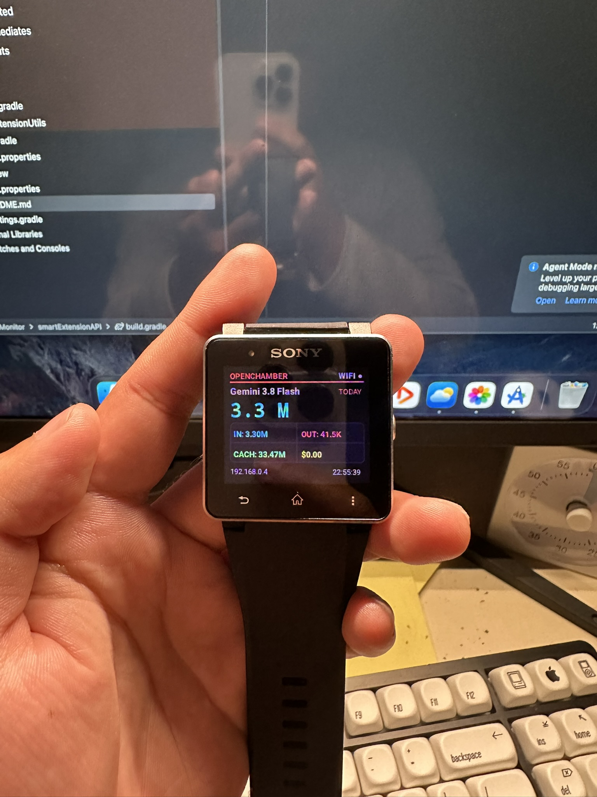
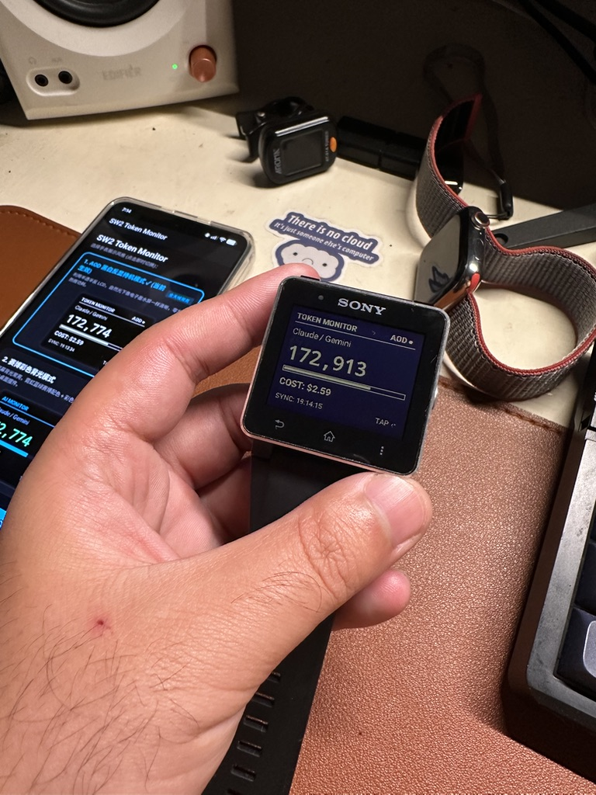

# SW2 Token Monitor (Cyberdeck AOD AI Dashboard)

<p align="center">
  
</p>

<p align="center">
  <strong>Turn a vintage Sony SmartWatch 2 into a real-time, low-power AI token monitor & desk cyberdeck display.</strong>
</p>

<p align="center">
  <a href="https://github.com/stan23333/SW2TokenMonitor/releases/latest">
    
  </a>
  <a href="https://github.com/stan23333/SW2TokenMonitor/releases/download/v1.0.0/SW2TokenMonitor-v1.0.0.apk">
    
  </a>
  
  
  
  
  
</p>

---

## 🌟 Overview

**SW2 Token Monitor** breathes modern life into the iconic 2013 **Sony SmartWatch 2 (SW2)**. By taking advantage of its unique **Transflective LCD (Memory LCD-like display)**, this project turns the vintage watch into a zero-burn-in, ultra-low-power, always-on desktop display (AOD) for tracking LLM token consumption in real time.

When connected to your local network, your computer (running **OpenChamber / OpenCode**) pushes real-time token telemetry directly to your Android device via Wi-Fi or ADB tunnel. The Android app instantly syncs data to an elegant **Material Design 3 (Material You)** home screen widget and pushes custom bitmap frames straight to the Sony SmartWatch 2 over Bluetooth.

---

## 🎨 Watch UI Themes & Display Modes

All watch displays feature real data readouts, including model name, today's total tokens, input/output breakdown, cache hits, estimated cost, local IP, and sync timestamps:

| 1. AOD Standby (Daylight E-Ink Style) | 2. Cyber Neon (Active Backlight) | 3. Synthwave Purple (Vaporwave) |
| :---: | :---: | :---: |
|  |  |  |
| **Pure 1-Bit B&W Monochrome**<br>No backlight, zero battery drain, high-contrast daylight readability. | **Electric Cyan & Lime Green**<br>High-energy cyberpunk neon aesthetic with active backlight. | **Fluorescent Magenta & Cyan**<br>Retro vaporwave palette on deep nebula purple background. |

| 4. Matrix Aurora (Emerald) | 5. Material You (Tonal M3) | App & Extension Icon |
| :---: | :---: | :---: |
|  |  |  |
| **Icy Emerald & Mint Green**<br>Cool terminal hacker aesthetic on deep graphite background. | **Lavender & Soft Coral**<br>Warm Morandi tones matched with modern Android 15 aesthetics. | Modern 512x512 adaptive icon for Android and SW2 launcher drawer. |

---

## 📱 Android Home Screen Widget (Material Design 3)

The Android companion application includes a native **4x2 Material You (M3)** widget featuring rounded pill containers, Morandi color harmonies, and responsive live token telemetry:

<p align="center">
  
</p>

---

## ✨ Features

- **⚡ Instant Real-Time Sync**: Pushes new token metrics to your watch within milliseconds of every AI generation.
- **☀️ Zero-Power Transflective AOD Mode**: Full daylight readability without backlight—mimicking E-Ink with zero heat and days of standby battery.
- **🎨 Dual-Mode Adaptive Rendering**:
  - **Standby (AOD)**: Sharp, non-aliased 1-bit monochrome graphics.
  - **Awake (Active Backlight)**: Smooth, colorful cyberpunk, synthwave, aurora, and Material You aesthetics.
- **📱 Material Design 3 (M3) Android Widget**: A 4x2 customizable home screen widget with rounded card surfaces, compact metrics, and live sync timestamps.
- **🖥️ Native OpenChamber / OpenCode Plugin**: Zero background bloatware on macOS/Linux. Written as a native ES-module plugin that hooks directly into OpenCode's message lifecycle.
- **🛡️ Bulletproof Dual-Route Delivery**: Automatically attempts LAN Wi-Fi direct connection (`http://<phone-ip>:8888/sync`) with automatic failover to local ADB shell tunneling.
- **🔋 Intelligent Heartbeat & Instant Bus**: Instant frame dispatch via internal broadcast when telemetry arrives, with a power-friendly 5-minute background timer that survives Android Doze mode.

---

## 🏗️ Architecture

```text
┌──────────────────────────────────────────────┐
│  Mac / Linux Workstation                     │
│  OpenChamber / OpenCode                      │
│                                              │
│  ~/.config/opencode/plugins/token-monitor    │
│  └── Listens to message.created / session   │
└──────────────────────┬───────────────────────┘
                       │
                       │ HTTP POST (LAN Wi-Fi / ADB tunnel)
                       ▼
┌──────────────────────────────────────────────┐
│  Android Host Device (e.g. Redmi / Pixel)    │
│                                              │
│  ┌────────────────────────────────────────┐  │
│  │ LocalHttpServer (Port 8888, Singleton) │  │
│  └───────────────────┬────────────────────┘  │
│                      │                       │
│         ┌────────────┴────────────┐          │
│         ▼                         ▼          │
│  ┌──────────────┐          ┌──────────────┐  │
│  │ M3 Widget    │          │ WatchPusher  │  │
│  │ (AppWidget)  │          │ (Raw Intent) │  │
│  └──────────────┘          └──────┬───────┘  │
└───────────────────────────────────┼──────────┘
                                    │
                                    │ Bluetooth 3.0 RFCOMM
                                    ▼
┌──────────────────────────────────────────────┐
│  Sony SmartWatch 2 (SW2)                     │
│  220x176 Transflective LCD                   │
│                                              │
│  • Standby: AOD Low-Power Mode (B&W)         │
│  • Tap / Wake: Color Theme (Neon / M3)       │
└──────────────────────────────────────────────┘
```

---

## 🔌 OpenCode / OpenChamber Push Plugin

The computer push mechanism is packaged as an official native OpenCode plugin located in [`opencode-plugin/`](opencode-plugin/):

- **Event-Driven Hook**: Listens to OpenCode's session context hooks (`session.hook("context")`) and streaming events (`message.created`, `message.updated`).
- **Zero OS Daemon Footprint**: No persistent macOS LaunchAgents or background daemons. Runs entirely within the OpenCode/OpenChamber process lifecycle.
- **Dual-Mode Delivery**: Directly streams JSON payloads to your Android device via LAN HTTP, and gracefully falls back to ADB port forwarding if Wi-Fi network isolation or VPN proxies are active.

```javascript
// opencode-plugin/index.js snippet
export default {
  id: 'token-monitor',
  setup(ctx) {
    if (ctx && ctx.session && typeof ctx.session.hook === 'function') {
      ctx.session.hook('context', async () => {
        setTimeout(() => fetchStatsAndPush('session_hook_context'), 1500);
      });
    }
  }
};
```

---

## 🚀 Getting Started

### Prerequisites

1. **Sony SmartWatch 2 (SW2)** (Charged and paired to your phone via Bluetooth).
2. **Android Phone** (Android 4.1 through modern Android 14/15/16).
3. **Computer** running [OpenCode](https://opencode.ai) or [OpenChamber](https://github.com).

---

### Step 1: Install Sony Companion Services on Modern Android

Modern Android versions block apps targeting older SDKs by default. Bypass this restriction with `adb`:

```bash
# Install Sony Smart Connect & SW2 Host plugin
adb install --bypass-low-target-sdk-block SmartConnect.apk
adb install --bypass-low-target-sdk-block SmartWatch2.apk

# Grant required background & bluetooth runtime permissions
adb shell pm grant com.sonyericsson.extras.liveware android.permission.BLUETOOTH_CONNECT
adb shell pm grant com.sonymobile.smartconnect.smartwatch2 android.permission.BLUETOOTH_CONNECT
adb shell cmd appops set com.sonyericsson.extras.liveware RUN_IN_BACKGROUND allow
adb shell cmd appops set com.sonymobile.smartconnect.smartwatch2 RUN_IN_BACKGROUND allow
```

Pair your Sony SmartWatch 2 with your phone via NFC or standard Bluetooth settings.

---

### Step 2: Install SW2 Token Monitor APK

You can directly download the pre-compiled APK from GitHub Releases:

👉 **[Download SW2TokenMonitor-v1.0.0.apk](https://github.com/stan23333/SW2TokenMonitor/releases/download/v1.0.0/SW2TokenMonitor-v1.0.0.apk)**

Install it to your device:
```bash
adb install -r -d SW2TokenMonitor-v1.0.0.apk
```

*(Alternatively, build from source using `./gradlew assembleDebug`)*

---

### Step 3: Install the OpenChamber / OpenCode Plugin

1. Create the plugin directory:
   ```bash
   mkdir -p ~/.config/opencode/plugins/token-monitor
   ```
2. Copy the plugin files from this repository:
   ```bash
   cp opencode-plugin/index.js ~/.config/opencode/plugins/token-monitor/index.js
   cp opencode-plugin/package.json ~/.config/opencode/plugins/token-monitor/package.json
   ```
3. Edit `PHONE_IP` in `~/.config/opencode/plugins/token-monitor/index.js` to match your phone's Wi-Fi IP address.
4. Restart OpenChamber / OpenCode. The plugin will automatically appear under **Settings → Plugins** as `token-monitor (Loaded)`.

---

## 🕹️ Usage & Interactions

- **Single Tap on Watch**: Instantly triggers a re-render and updates the timestamp.
- **Theme Selection in Android App**:
  - *Material You (M3)*: Soft lavender, tonal surfaces, and morandi indicators.
  - *Cyber Neon*: Vivid electric cyan and glowing lime green.
  - *Synthwave Purple*: Retro vaporwave aesthetic with deep purples and pinks.
  - *Matrix Aurora*: Minimalist deep emerald matrix palette.
  - *Classic Monochrome*: Sharp black-and-white for minimalists.
- **Android Home Screen Widget**: Long press on your home screen, tap **Widgets**, find **SW2 Token Monitor**, and place the 4x2 card on your screen.

---

## 📸 Real Hardware Showcase

<p align="center">
  
  
</p>

> **Left**: SW2 running in **Active Color Mode**, showcasing live telemetry pushed directly from OpenChamber on macOS (`Gemini 3.8 Flash`, `3.3 M` total tokens, `IN`, `OUT`, `CACHE`, and estimated cost).  
> **Right**: SW2 running in **AOD Low-Power Mode (Transflective LCD)** with the Android companion app on the host phone, achieving sharp readability under ambient desk lighting with zero backlight power draw.

---

## 🛠️ Tech Stack & SDK Notes

- **Language**: Java 17 / Android SDK Platform 34 (UpsideDownCake)
- **Architecture**: Modernized refactor of the original 2013 `Sony Add-on SDK 3.0` (`smartExtensionAPI` and `smartExtensionUtils`) into standard standalone Gradle AAR modules.
- **Networking**: Lightweight embedded multi-threaded HTTP socket server.
- **CI/CD**: GitHub Actions workflow (`.github/workflows/build-release.yml`) for automated cloud APK builds & releases.
- **OpenCode Plugin**: Node.js ES-Module hook capturing SQLite database delta statistics (`~/.local/share/opencode/opencode.db`).

---

## 📄 License

This project is licensed under the Apache License 2.0. Original Sony Add-on SDK sample components belong to Sony Mobile Communications Inc.
